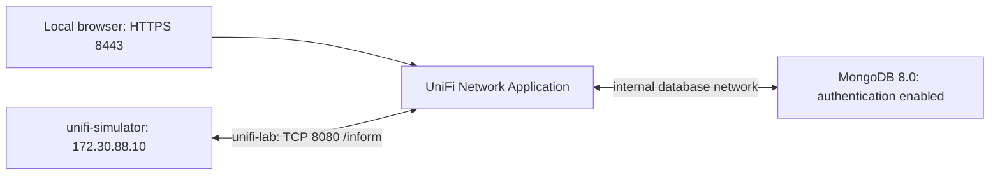

# Complete local UniFi + simulator lab

Two independent Compose projects share a dedicated bridge network, `unifi-lab`.
The controller owns this network; the simulator joins it as an external network.
MongoDB lives on another, internal network, reachable only by the controller.
No host networking, real UniFi equipment or RouterOS credentials are required.
That remains the default synthetic mode. To use the RB760iGS at 192.168.0.249:8728,
follow [M2 read-only RouterOS setup](../../docs/routeros.md) and merge
`compose.routeros.yml` into the simulator project. It preserves the existing adoption
volume and uses a local password secret, without adding the simulator to the database network.



## Start

Requires Docker Engine, Compose v2, Python 3 for the optional password generator, and
at least about 3 GiB free RAM for the complete stack. MongoDB 8.0 requires an AVX-capable
x86_64 CPU (or a supported ARM64 host). Run from this directory:

```sh
cd deploy/lab
python3 init-env.py
docker compose -f compose.unifi.yml up -d --wait --wait-timeout 240
docker compose -f compose.unifi.yml logs -f unifi-network-application
```

`init-env.py` creates a mode-0600, Git-ignored `.env` with separate random root/application
database passwords; it preserves existing settings and never prints the passwords.
Alternatively copy `.env.example` to `.env`, protect the file, and fill both passwords.
Use URL-safe values (the generator uses hex) because LinuxServer builds a MongoDB URI.

Open your local browser using HTTPS on host 127.0.0.1, port 8443. Complete the UniFi
setup wizard and create your own **lab** administrator. The image has a self-signed UI
certificate; trust that certificate explicitly. Compose `--wait` confirms authenticated
MongoDB readiness and controller container startup, not wizard completion. Follow the
controller logs until the application finishes starting.

Leave **Inform Host Override** unset initially. The updated emulator uses Docker DNS
for its connection and reports the controller's resolved IPv4 address in the inform
payload. UniFi 10.6.106 rejects a DNS hostname in that payload during adoption. If you
need an override, use the controller's reachable IPv4 address, not
`unifi-network-application`; inspect the controller's `unifi-lab` network address and
remember it can change when the container is recreated. Port 8080 remains the device-side
inform port; 8443 is the UI port. See [the HTTP 400 fix](../../docs/adoption.md).

Then build/start the simulator using the second Compose file:

```sh
docker compose -f compose.simulator.yml up -d --build
docker compose -f compose.simulator.yml logs -f emulator
docker compose -f compose.simulator.yml exec emulator mtunifi diagnose
```

The simulator now loads [the M1 demo](../../examples/synthetic-switch.json): eight
configurable ports, growing counters, three wired clients and two LLDP neighbors.
Edit a local JSON scenario for live changes without new adoption. For fields,
read-only mounts, counter resets and controller caching limitations, see
[synthetic telemetry](../../docs/synthetic-telemetry.md). Existing `.env` and adoption
volumes are preserved; MTUNIFI_SCENARIO defaults to `synthetic-switch.json`.

In the UniFi Devices view, look for the fresh synthetic switch and choose Adopt if it
appears. The simulator talks directly to `http://unifi-network-application:8080/inform`.
Its fixed IP is also the IP reported in telemetry. It needs no published ports.
Verify Adopted/Connected in the UI for at least five minutes; the simulator's
`exchanging` phase/health status cannot establish controller-side adoption.

The emulator remains experimental. A subsequent adoption experiment with 10.6.106 is
recorded in [validation](../../docs/validation.md); it does not establish compatibility
with future `latest` images. The older 8.0.24 experiment and unresolved protocol questions are in
[validation](../../docs/validation.md) and [adoption](../../docs/adoption.md).

## Images and persistent data

The default is your preferred `lscr.io/linuxserver/unifi-network-application:latest`.
MongoDB is fixed to the 8.0 series, supported by UniFi Network 9.0+ according to
[LinuxServer's documentation](https://docs.linuxserver.io/images/docker-unifi-network-application/).
This is a current-release lab; it does not silently replace the separate 8.0.24 lab.
For reproducible experiments, set UNIFI_IMAGE to a tested version/digest and record
the actual application version. Do not pair a controller older than 9.0 with MongoDB 8.0.
Do not change MongoDB major versions on an existing volume without a supported migration.

Named volumes retain UniFi configuration, MongoDB data/config and simulator adoption
state. MongoDB initialization and LinuxServer's database settings run **only on the
first initialization**. Changing `.env` passwords afterwards does not rotate existing
database users or update an already initialized UniFi configuration. Preserve `.env`
alongside private backups. No credentials are hardcoded or stored in Git.

The simulator's new project/state volume is independent of the original root Compose
and the older `compose.lab.yml`, so a previously adopted identity is not reused.
The two project names also make stopping one stack independent of the other.

## Network and ports

| Network/port | Exposure |
| --- | --- |
| `unifi-lab`, default 172.30.88.0/24 | Dedicated Docker bridge for controller + simulator |
| Controller project's `database` | Internal Docker network for controller + MongoDB only |
| Host 127.0.0.1:8443/TCP | UniFi web UI |
| Controller 8080/TCP | Internal inform endpoint, reachable by simulator without host publishing |
| MongoDB 27017/TCP | Internal database network only; no host port and no simulator attachment |
| Simulator | No published ports |

The lab bridge has normal outbound access for updates; it is not a separate VM or a
guarantee of isolation from the host. MongoDB's network is `internal: true`.
No 3478/10001 UDP mapping is needed by this outbound-only emulator. Guest portal,
discovery, mobile speed test and remote syslog ports from the example are optional
features outside this synthetic lab and are omitted. Docker bridge discovery is not
equivalent to physical LAN discovery.

To access the UI from another computer, set UNIFI_BIND_IP to the host's specific LAN
address and restrict access in the host firewall. Set UNIFI_HTTPS_PORT if 8443 is occupied.
If 172.30.88.0/24 conflicts with your LAN/VPN/Docker routes, change UNIFI_LAB_SUBNET and
UNIFI_SIMULATOR_IP **before first startup**; the simulator address must be in that subnet.
Changing UNIFI_LAB_NETWORK requires the same `.env` for both projects. The controller
must create the network before the simulator can start.

## Stop, restart and inspect

```sh
docker compose -f compose.simulator.yml stop
docker compose -f compose.unifi.yml stop
# Later: start controller first, then simulator.
docker compose -f compose.unifi.yml up -d
docker compose -f compose.simulator.yml up -d
# Inspect services without displaying rendered secret environment values:
docker compose -f compose.unifi.yml ps
docker compose -f compose.simulator.yml ps
```

To remove containers and networks while keeping data, run simulator `down` first,
then controller `down`. This releases the external network before its owner removes it.
Do not use `down -v` unless deliberately erasing the corresponding disposable lab's data.
Keep controller and simulator data together to preserve their adoption relationship.

For database startup failures inspect `logs unifi-db`; ensure passwords were set before
the first volume initialization. Do not publish 27017 to troubleshoot. For simulator
HTTP 400/404 or stalled adoption, see [protocol diagnosis](../../docs/adoption.md).
If you deleted an adopted device in UniFi, use the documented `reset-adoption`
procedure to preserve its MAC and scenario while removing the obsolete adoption key.
If an existing network was created manually or by another project with the same name,
choose a different UNIFI_LAB_NETWORK; the controller project must own its bridge.

## Cloud build behind a trusted HTTPS proxy

Only in the existing Codex cloud, run the simulator build from the repository root:

```sh
BUILDX_CONFIG=/workspace/.cache/buildx docker compose --env-file deploy/lab/.env \
  -f deploy/lab/compose.simulator.yml -f compose.cloud.yml build
```

This supplies the host CA bundle to the existing verified build, without disabling TLS.
Ordinary local hosts use the normal build command. If `lscr.io` is unavailable, the
same vendor publishes `ghcr.io/linuxserver/unifi-network-application:latest`; an explicit
UNIFI_IMAGE override can use it, but record the version/digest used for the experiment.

## Initial deployment validation on 2026-10-15 (before adoption fix)

The results below describe the original deployment check. Subsequent real adoption
and Connected observations for 10.6.106, including the DNS payload fix, are recorded
in [the updated protocol validation](../../docs/validation.md).

Both Compose definitions were validated with Docker Compose 2.40.3. The simulator
image built using the existing cloud CA override. First initialization of a fresh
MongoDB volume succeeded with authentication and all four application database roles
plus clusterMonitor; its health check passed. The public initialization file must be
readable by MongoDB's container user (Git mode 0644).

The complete stack started successfully using the official vendor's GHCR mirror
because this cloud denied access to lscr.io. Observed image:
`ghcr.io/linuxserver/unifi-network-application:latest`, application 10.6.106,
LinuxServer build `10.6.106-ls150`, manifest digest
`sha256:4d5fc889c2f2c2cecc6b35d4d641780cbedbe90d3a51b8f03283261b137af468`.
MongoDB image: `mongo:8.0`, manifest digest
`sha256:6657bf2413fefc5be649390318f5b4cd7328e982722f8ce2ac6dfa6f0a42cb03`.
The default Compose image remains the requested lscr.io image.

From the running simulator, Docker DNS resolved the controller and an actual HTTP
request to its internal `/status` endpoint returned `meta.rc=ok`. Actual network
memberships and static simulator IP matched the configuration; the simulator could
not resolve `unifi-db` and neither it nor MongoDB published any host ports. The
generated `.env` was mode 0600 and running the generator again preserved its contents.

The setup wizard was not completed and no administrator or adopted switch was created.
Initial synthetic inform received HTTP 404; adoption/Connected and telemetry rendering
are **not proven** by this deployment check. Test containers were stopped afterwards;
local settings and named volumes were retained, never added to Git.
