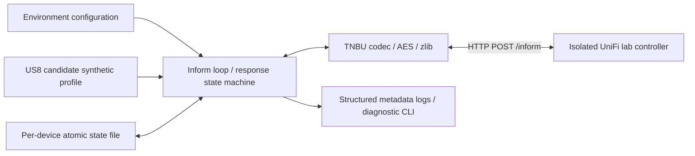

# Architecture and milestone boundary

M0/M1 implement a single synthetic device using outbound UniFi device protocol. There
is no dashboard, controller API facade, RouterOS integration or automatic network discovery.

`config.py`: validated settings, no credential-bearing URLs. `protocol.py`: bounded
binary codec, independent of networking. `scenario.py`: strict Pydantic lab models,
file hot reload, monotonic counters, active clients and neighbors. `telemetry.py` maps
the synthetic snapshot to source-supported fields. `emulator.py`: serialized state transitions,
bounded HTTP transport, retry loop and allowlisted management metadata. `storage.py`:
exclusive Linux file lock, atomic mode-0600 state replacement and fsync. `main.py`:
CLI, safe diagnostics and health command. A state volume survives process/container restarts.

`transport.py` resolves the controller's IPv4 address for the device-side JSON inform_url.
UniFi 10.6.106 rejects a DNS hostname in that field during adoption. The actual HTTP URL,
TLS hostname and stored controller binding retain the configured DNS name, allowing
Docker DNS updates without binding an identity permanently to a transient container IP.

The private adoption key is issued by the controller and persisted. No TLS/SSH device
keypair is generated because the implemented outbound protocol does not use one.
The public bootstrap constant is used only before receiving a private key. There is
no key downgrade fallback. HTTP redirects and proxy-environment routing are disabled
for inform traffic; HTTPS uses normal certificate validation. A trusted private CA can
be installed in the runtime trust store; never disable certificate verification.

Future RouterOS collector -> vendor-neutral snapshot -> switch mapper will replace
the synthetic source. Separate logical/physical interfaces and confidence/provenance
are required; see `routeros-mapping.md`. One Emulator/Store per device isolates keys,
controller state, collectors and reconnect handling. Only one process/device is exposed
by the CLI; multi-device orchestration is deliberately deferred.

The scenario file is mounted as part of a read-only directory. Invalid runtime edits
retain the last valid in-memory scenario; invalid initial configuration fails startup.
Counter state is per-process and resets with device uptime on restart; it never changes
the persistent adoption identity. A separate atomic `telemetry.json` stores the latest
generated diagnostic snapshot without copying adoption keys into it. Real collection
and vendor-neutral normalization remain later milestones.

State does not persist raw controller configuration. CLI health checks recent valid
protocol exchange and last-error status, not controller UI state. Health does not probe
the controller or start/change identity. No inbound application endpoint is exposed.
