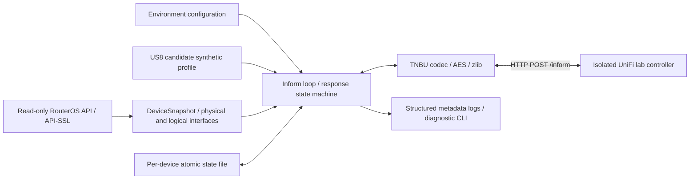

# Architecture and milestone boundary

M0–M4 implement a single emulator using outbound UniFi device protocol, with either
synthetic telemetry or read-only RouterOS collection. There is no dashboard,
controller API facade or automatic network discovery.

`config.py`: validated settings, no credential-bearing URLs. `protocol.py`: bounded
binary codec, independent of networking. `scenario.py`: strict Pydantic lab models,
file hot reload, monotonic counters, active clients and neighbors. `telemetry.py` maps
the synthetic snapshot to source-supported fields. `emulator.py`: serialized state transitions,
bounded HTTP transport, retry loop and allowlisted management metadata. `storage.py`:
exclusive Linux file lock, atomic mode-0600 state replacement and fsync. `main.py`:
CLI, safe diagnostics and health command. A state volume survives process/container restarts.
`sources.py` selects exactly one telemetry source. `routeros_api.py` implements bounded
native API sentences, verified TLS or explicit plaintext TCP, and a hard command
allowlist. `routeros.py` collects/normalizes observations with an explicit port map,
bounded polling and reconnect backoff. `snapshot.py` keeps vendor-neutral models and
maps up to eight physical ports into the existing US8 slots.
`clients.py` correlates FDB identity/attachment with scoped optional ARP/DHCP metadata,
excludes local MACs and tracks continuous observations without persisting client history.
`neighbors.py` normalizes RouterOS neighbor-cache evidence, preserves protocol/port
uncertainty and exports only eligible LLDP observations. It never creates inferred
switches from FDB entries. `routeros_values.py` shares bounded API value parsers.

`transport.py` resolves the controller's IPv4 address for the device-side JSON inform_url.
UniFi 10.6.106 rejects a DNS hostname in that field during adoption. The actual HTTP URL,
TLS hostname and stored controller binding retain the configured DNS name, allowing
Docker DNS updates without binding an identity permanently to a transient container IP.

The private adoption key is issued by the controller and persisted. No TLS/SSH device
keypair is generated because the implemented outbound protocol does not use one.
The public bootstrap constant is used only before receiving a private key. There is
no key downgrade fallback on HTTP errors. The explicit `reset-adoption` command or
a private-key `setdefault` clears adoption metadata while retaining MAC and controller
binding; the next inform uses bootstrap again. HTTP redirects and proxy-environment routing are disabled
for inform traffic; HTTPS uses normal certificate validation. A trusted private CA can
be installed in the runtime trust store; never disable certificate verification.

RouterOS collection separates logical and physical interfaces and records unavailable
fields rather than guessed values. FDB attachment uses bridge/MAC/VID identity and
explicit physical mapping; `None` versus empty client inventories preserves unavailable
versus authoritative empty FDB. A source gap clears observation timing; MAC tables
are omitted on FDB failure while port informs continue. Neighbor inventories similarly
distinguish unavailable from empty, retaining partial invalid evidence diagnostically.
See `topology.md` for provenance and conservative export rules. One Emulator/Store per device isolates keys,
controller state, collectors and reconnect handling. Only one process/device is exposed
by the CLI; multi-device orchestration is deliberately deferred.

The scenario file is mounted as part of a read-only directory. Invalid runtime edits
retain the last valid in-memory scenario; invalid initial configuration fails startup.
Counter state is per-process and resets with device uptime on restart; it never changes
the persistent adoption identity. A separate atomic `telemetry.json` stores the latest
generated diagnostic snapshot without copying adoption keys into it. In RouterOS mode
this holds normalized observations, freshness, warnings and source error codes; it
never stores the API password. Required polling failure suppresses informs and keeps
the previous observation only for diagnosis, preserving the adoption key. RouterOS
uptime accompanies real counters, including after emulator restarts and device resets.

State does not persist raw controller configuration. CLI health checks recent valid
protocol exchange, selected-source freshness and last-error status, not controller UI state.
Health does not probe
the controller or start/change identity. No inbound application endpoint is exposed.
